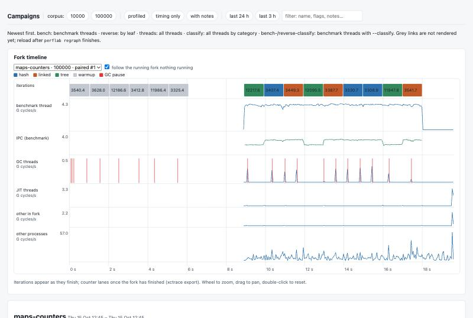
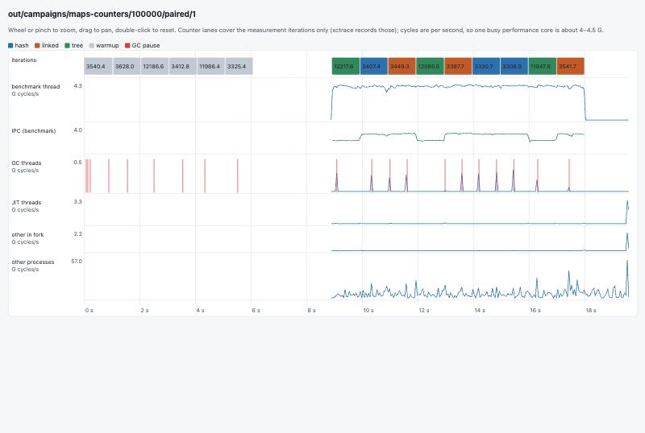
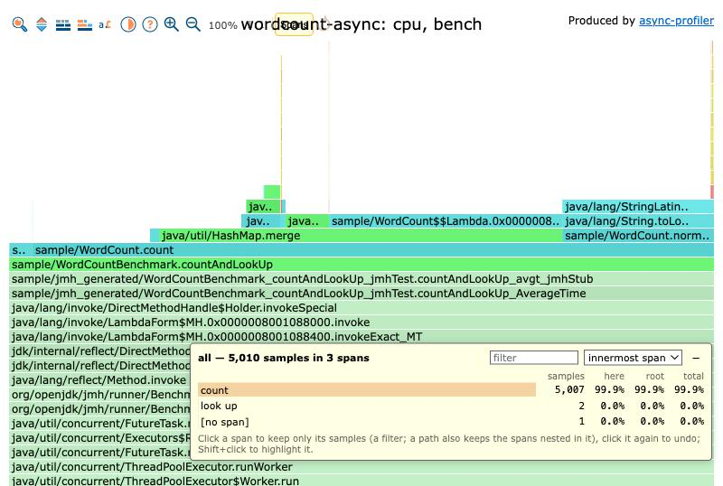
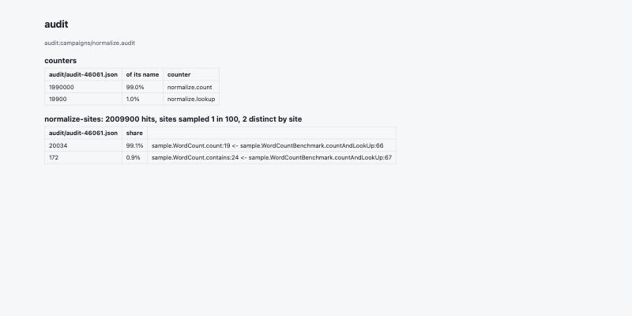
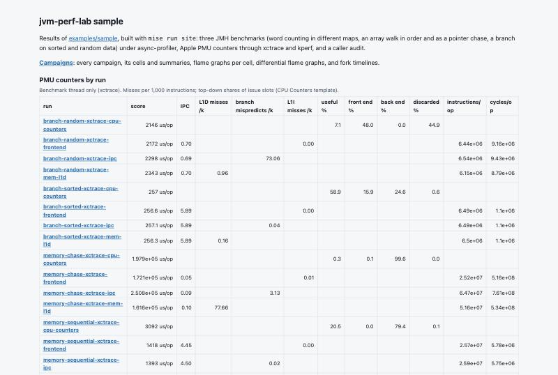
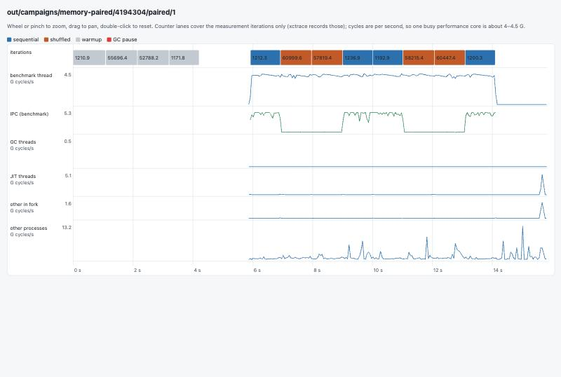

# jvm-perf-lab

JMH profilers and a Java agent for benchmarking JVM programs:

- default profilers for allocation and JIT activity
- variants compared within one fork, by iteration
- Apple Silicon PMU counters per thread, via `xctrace`
- an agent that counts the callers reaching a method

Requires Java 17. Design and plan: [doc/design.md](doc/design.md).

## Sample results

[retronym.github.io/jvm-perf-lab](https://retronym.github.io/jvm-perf-lab/): the campaigns, flame graphs and audit report of [examples/sample](examples/sample), built with `mise run site`.

| | |
|---|---|
| [](https://retronym.github.io/jvm-perf-lab/campaigns/) | [](https://retronym.github.io/jvm-perf-lab/campaigns/maps-counters/100000/paired/1/timeline.html) |
| Campaigns, with the fork timeline: iterations of three variants interleaved, the benchmark thread's cycles and IPC, GC, JIT and other processes | One fork's timeline: GC pauses from the GC log beside the GC threads' cycles |
| [](https://retronym.github.io/jvm-perf-lab/) | [](https://retronym.github.io/jvm-perf-lab/runs/audit/report.html) |
| async-profiler, benchmark threads | A caller audit: calls to `normalize`, by caller |
| [](https://retronym.github.io/jvm-perf-lab/) | [](https://retronym.github.io/jvm-perf-lab/campaigns/memory-paired/4194304/paired/1/timeline.html) |
| PMU counters by run (xctrace): IPC, L1D and branch misses per 1000 instructions, top-down split | Pointer chase over a sequential vs shuffled array in one fork: IPC drops from about 4.5 to 0.1 in the shuffled iterations |

## Modules

**`perflab-jmh`**: depend on it from the benchmarks (JMH itself is `provided`, so your build picks the version).

- `io.github.retronym.perflab.jmh.Main`: `org.openjdk.jmh.Main` with default profilers (`gc`, `JitProfiler`, `PairedProfiler`). Use it as the benchmark's main class. It takes `@file` arguments (the file's lines, one argument each, unquoted) and `&` between a profiler's options, for build tools that split a command at `;` (sbt).
- `JitProfiler`: compilations, compile time and deoptimizations while measuring and in the last warmup iteration.
- `Variants`, `IterationLog`, `PairedProfiler`: compare variants that a benchmark can switch between iterations (e.g. compiler settings) within one fork, in a Williams design, so they share the fork's compiled code. Reports time per variant and paired differences ([doc/paired-ab.md](doc/paired-ab.md)).
- `xctrace.XctraceProfiler`: Apple Silicon PMU counters through `xctrace`, for the benchmark thread separately from JIT, GC and other threads, per variant when variants alternate, plus per-method attribution and a 50 ms timeline. Bundled templates: `template=ipc`, `frontend`, `mem-l1d`.

**`perflab-agent`**: a `-javaagent` jar for caller audits ([doc/caller-audit.md](doc/caller-audit.md)): probes woven into the program as it loads, from a spec, counting hits, distinct call sites and creation-site tags.

```
java -javaagent:perflab-agent.jar=spec=envelope.audit,out=audit-{pid}.json ...
```

**`perflab`** (Python 3.11+, `python/`): runs and analyses benchmarks through a project's build.

| command | |
|---|---|
| `perflab run --profile <p> -- <jmh args>` | one run under a profile: `none`, `xctrace:<template>`, `async:<events>`, `audit:<spec>`; flame graphs or an audit report afterwards |
| `perflab ab run\|report <spec>` | campaigns: variants over corpora, interleaved by round or paired within forks, each run checked |
| `perflab trees <spec>` | campaigns across checkouts |
| `perflab index` | `index.html` over all campaigns, with a live timeline of the running fork |
| `perflab regraph`, `profdiff`, `frameweight`, `subtree`, `analyze` | flame graphs and analysis of async-profiler runs |
| `perflab auditfold` | merging and folding audit reports |
| `perflab loadgate` | waiting for a quiet machine; sampling competing load |

## In a build

The build passes perflab's arguments to the driver as an `@file`. A project's `perflab.toml` names the command, e.g. for sbt with sbt-jmh:

```toml
[build]
jmh = "sbt --client 'bench/Jmh/run {args}'"
server = "sbt"
```

```scala
libraryDependencies += "com.github.retronym.jvm-perf-lab" % "perflab-jmh" % "<tag>"   // resolvers += "jitpack" at "https://jitpack.io"
Jmh / run / mainClass := Some("io.github.retronym.perflab.jmh.Main")
```

[examples/sample](examples/sample) is a Maven project set up this way, with campaign and audit specs.

## Building

`mise run build` (Java 21 builds the Java 17 release), `mise run test`, `mise run install` for a snapshot in `~/.m2`, `mise run cli` to install `perflab`, `mise run site` and `mise run publish-site` for the sample results.

Licensed under the Apache License 2.0.
